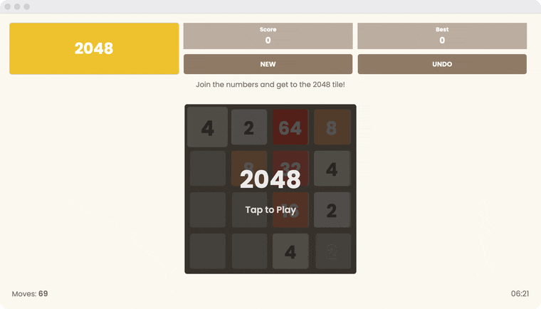
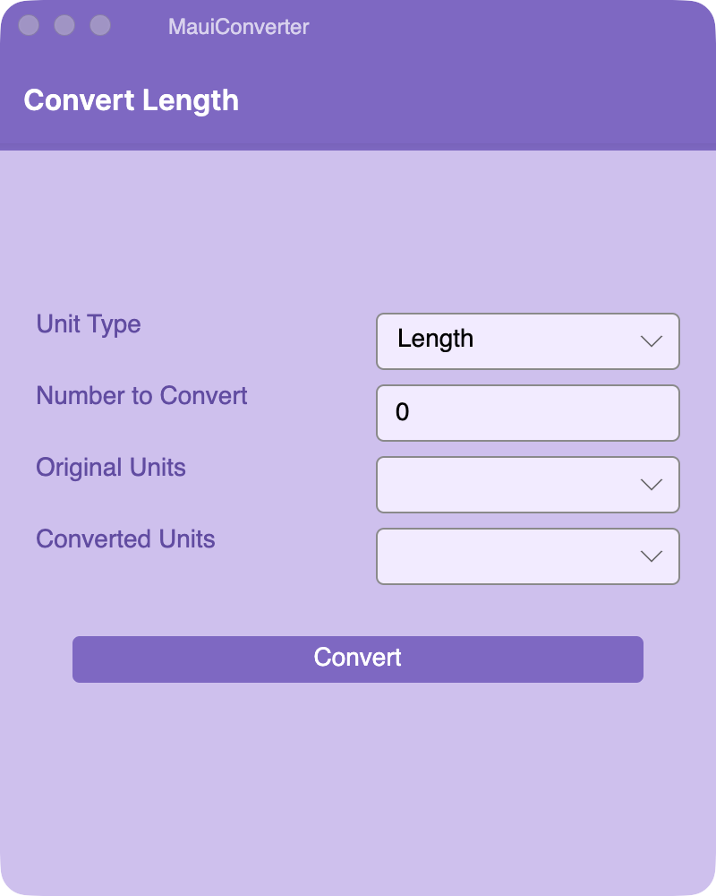
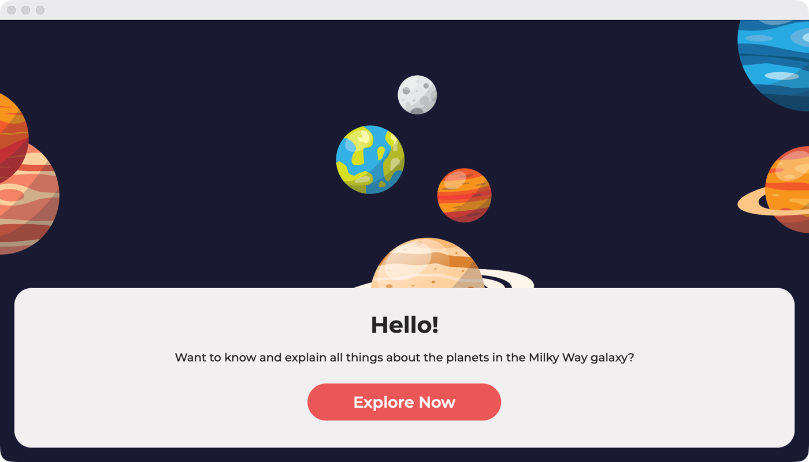
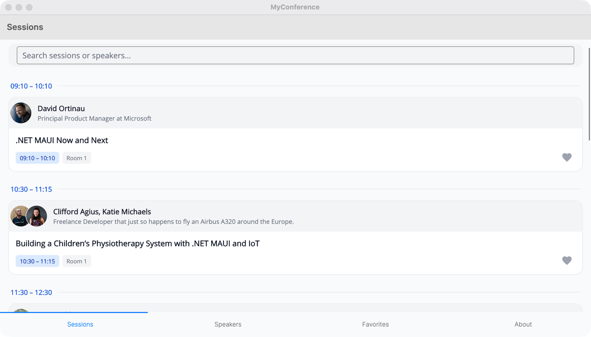
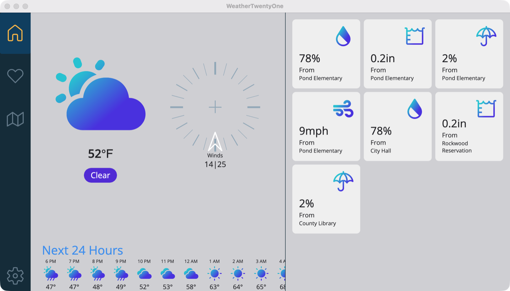

# Avalonia.Controls.Maui Samples

Samples built with The [Avalonia-based handlers](https://github.com/AvaloniaUI/Avalonia.Controls.Maui) for the .NET Multi-platform App UI ([.NET MAUI](https://github.com/dotnet/maui)) framework.

Most of these apps are ports of existing .NET MAUI apps. Each entry links to the original project.

| App | Description | Original |
| --- | --- | --- |
| [2048Game](#2048game) | The 2048 sliding tile puzzle | [codeanees/2048Maui](https://github.com/codeanees/2048Maui) |
| [AlohaAI](#alohaai) | Learning paths, lessons and quizzes about AI | [kubaflo/AlohaAI](https://github.com/kubaflo/AlohaAI) |
| [AlohaKit.Gallery](#alohakitgallery) | Gallery of the AlohaKit drawn controls | [jsuarezruiz/AlohaKit](https://github.com/jsuarezruiz/AlohaKit) |
| [MapApp](#mapapp) | OpenStreetMap viewer built with Mapsui | Written for this repo |
| [MauiConverter](#mauiconverter) | Unit converter written in C# Markup | [TheCodeTraveler/MauiConverter](https://github.com/TheCodeTraveler/MauiConverter) |
| [MauiPlanets](#mauiplanets) | Explore the planets of the solar system | [naweed/MauiPlanets](https://github.com/naweed/MauiPlanets) |
| [MyConference](#myconference) | Conference sessions, speakers and favorites | [jfversluis/myconference](https://github.com/jfversluis/myconference) |
| [WeatherTwentyOne](#weathertwentyone) | Weather dashboard from the .NET MAUI samples | [dotnet/maui-samples](https://github.com/dotnet/maui-samples/tree/main/10.0/Apps/WeatherTwentyOne) |

## Apps

### 2048Game

The classic 2048 puzzle: slide the tiles and merge matching numbers until you reach 2048. It keeps the current and best score, supports undo, and plays a demo game behind the start screen.

Original: [codeanees/2048Maui](https://github.com/codeanees/2048Maui)

### AlohaAI

A pocket guide to AI with learning paths on topics such as ML fundamentals, generative AI, prompt engineering, agentic AI and AI safety. Each path has lessons and quizzes, and there's a chat page and a profile that tracks XP, streaks and completed lessons. The original app was written with GitHub Copilot.

Original: [kubaflo/AlohaAI](https://github.com/kubaflo/AlohaAI)

### AlohaKit.Gallery

The gallery app for AlohaKit, a set of drawn .NET MAUI controls. It shows avatars, buttons, check boxes, toggle switches, sliders, ratings, segmented controls, gauges, progress indicators and bar, line and pie charts.

Original: [jsuarezruiz/AlohaKit](https://github.com/jsuarezruiz/AlohaKit)

### MapApp

An interactive OpenStreetMap map built with [Mapsui](https://github.com/Mapsui/Mapsui) and rendered through the Avalonia SkiaSharp views. You can type a latitude and longitude, jump to a preset city or use the zoom controls. The current map center is shown in the corner.

### MauiConverter

A unit converter for length, mass, temperature and angle. The UI is written in C# Markup and the app uses custom Avalonia.Controls.Maui handler mappings.

Original: [TheCodeTraveler/MauiConverter](https://github.com/TheCodeTraveler/MauiConverter) by Brandon Minnick

### MauiPlanets

Browse the planets of the Milky Way, from a start page to a list of planets and a details page for each one.

Original: [naweed/MauiPlanets](https://github.com/naweed/MauiPlanets)

### MyConference

A conference app that loads its sessions and speakers from Sessionize, with search and a favorites list. It was created during a live stream about [using Copilot to build .NET MAUI apps](https://www.youtube.com/watch?v=9uO1rY2aswU). The port fixes dark and light themes, sets fonts, and adds trimming support and a CORS proxy so it also runs in the browser.

Original: [jfversluis/myconference](https://github.com/jfversluis/myconference)

### WeatherTwentyOne

A weather dashboard with current conditions, wind, a 24-hour forecast and a grid of weather widgets, plus favorites, map and settings pages. It was originally written for the .NET 6 release of .NET MAUI.

Original: [dotnet/maui-samples](https://github.com/dotnet/maui-samples/tree/main/10.0/Apps/WeatherTwentyOne)

